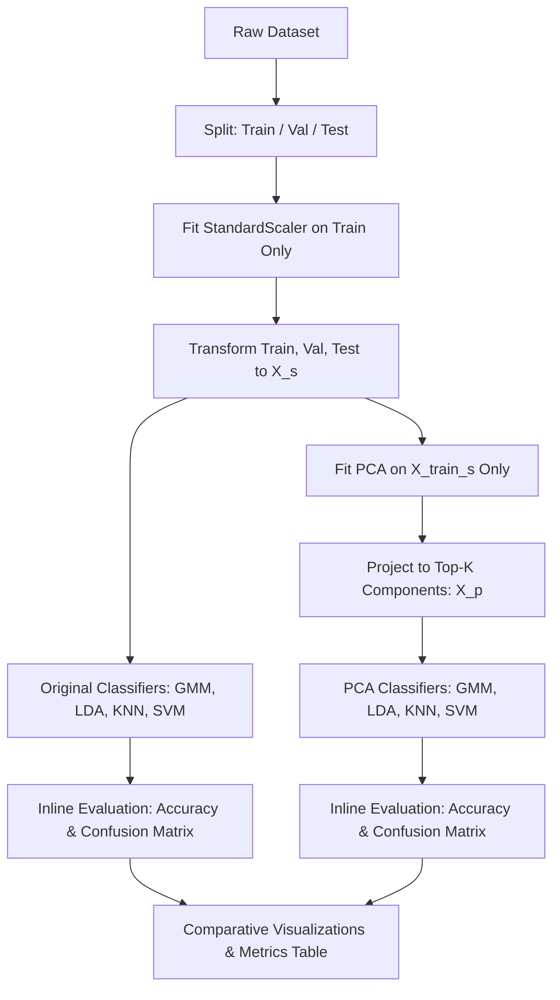

# **AI5707 — Pattern Recognition and Machine Learning**
## **Lab 8 Comprehensive Guide: Classification & Dimensionality Reduction**

---

### **1. Executive Summary & Objective**

The objective of Lab 8 is to perform an empirical comparison of four foundational pattern recognition algorithms:
1. **Gaussian Mixture Models (GMM)** — Probabilistic generative model with soft clustering via Expectation-Maximization (EM).
2. **Linear Discriminant Analysis (LDA)** — Parametric classifier with linear decision boundaries under a shared covariance assumption.
3. **K-Nearest Neighbours (KNN)** — Non-parametric instance-based classifier driven by local Euclidean neighborhoods.
4. **Support Vector Machines (SVM)** — Maximum-margin hyperplane classifier using non-linear RBF kernels.

The experiments are conducted across four diverse datasets. In addition to evaluating on the original feature representations, each dataset is projected onto its top **$K$ Principal Components (PCA)** to investigate how unsupervised variance-maximizing dimensionality reduction influences classifier accuracy, computational efficiency, and decision boundaries.

---

### **2. Datasets and Representations**

| Dataset | Nature | Total Samples | Classes | Original Dim | PCA Dim ($K$) | Retained Variance | Representation Used |
|---|---|---:|---|---:|---:|---:|---|
| **Synthetic** | Geometric Clusters | 20,000 | 2 (0, 1) | 16-D | 8 | ~72.7% | Continuous vectors |
| **MNIST** | Grayscale Digits | 21,660 | 3 (1, 8, 9) | 784-D | 40 | ~56.6% | $28 \times 28$ normalized pixel intensities |
| **Image Features** | Engineered Descriptors | 3,000 | 5 (0 to 4) | 36-D | 12 | ~69.4% | Hand-crafted tabular image descriptors |
| **TIDIGITS (Summaries)** | Audio Utterances | 1,350 | 3 (3, 7, 9) | 78-D | 20 | ~36.8% | Temporal mean & std across frames |
| **TIDIGITS (Frames)** | Audio Utterances | 1,350 | 3 (3, 7, 9) | Variable | 15 | ~67.8% | Ordered sequences of 39-D MFCC vectors |

---

### **3. Experimental Workflow**

All four notebooks follow a standardized workflow:

#### **Key Experimental Safeguards:**
* **No Data Leakage:** The `StandardScaler` and `PCA` transformers are fitted **strictly on the training partition**. Validation and test partitions are transformed using the saved training statistics (`mean_`, `scale_`, `components_`).
* **Self-Contained Evaluation:** Classification accuracy is computed transparently via `np.mean(y == y_pred)`, and confusion matrices are generated directly in each algorithm cell without external evaluation libraries.
* **Fair Splits:** Splits are kept identical across all original and PCA comparisons.

---

### **4. Detailed Code Walkthrough for Each Notebook**

#### **4.1 Notebook 01: `01_Synthetic.ipynb`**

1. **Imports:**
   * Imports standard scientific libraries (`numpy`, `matplotlib.pyplot`, `pickle`).
   * Imports custom algorithm classes from `src`: `GMMClassifier`, `LDA`, `KNN`, `SVM`, `PCA`, `StandardScaler`.
2. **Load and Split Data:**
   * Reads `data.pkl` using `pickle`.
   * Splits 20,000 samples into 60% Train (12,000), 20% Validation (4,000), and 20% Test (4,000) using a fixed random seed (`seed=42`).
3. **Feature Standardization:**
   * Centers features to zero mean and unit variance. Sets up `classes`, `label_to_idx`, and an empty `results = {}` dictionary.
4. **Original Feature Classifiers (Dedicated Blocks):**
   * **GMM Block:** Fits class-conditional diagonal GMM ($K=3$ components per class). Predicts via log-likelihood plus class priors. Computes accuracy and confusion matrix.
   * **LDA Block:** Fits Gaussian discriminant with shared pooled regularized covariance. Predicts class with highest linear discriminant score.
   * **KNN Block:** Stores training points; queries 5 nearest neighbors in chunks using Euclidean distance; votes by majority.
   * **SVM Block:** Uses an RBF kernel ($C=1.0$) trained with up to 1,500 support vector candidates for computational tractability.
5. **PCA Dimensionality Reduction:**
   * Reduces 16-D feature space down to $K=8$ principal components, retaining ~72.7% of total variance.
6. **PCA Classifiers (Dedicated Blocks):**
   * Retrains GMM, LDA, KNN, and SVM on the 8-D projected features and records validation and test metrics.
7. **Results Comparison:**
   * Displays a summary metrics table and plots a grouped bar chart comparing Validation vs. Test accuracy across all configurations.

---

#### **4.2 Notebook 02: `02_MNIST.ipynb`**

1. **Imports & Image Reader:**
   * Uses `zipfile` and `PIL.Image` to stream PNG images directly from `TEAM_3.zip` in memory without extracting tens of thousands of files to disk.
2. **Load MNIST Images:**
   * Reads 3 classes (Digits `1`, `8`, `9`). Converts $28 \times 28$ grayscale pixels into flattened 784-dimensional vectors normalized to $[0, 1]$.
   * Partitions: 14,833 Train, 3,709 Validation, 3,118 Test images.
3. **Feature Standardization & Setup:**
   * Fits `StandardScaler` to normalize pixel variance across images.
4. **Original Feature Classifiers (784 Dimensions):**
   * Runs GMM, LDA, KNN, and SVM on full 784-D pixel vectors.
   * SVM uses `max_train=1500` to maintain fast execution while obtaining sharp margin boundaries.
5. **PCA Compression ($K=40$):**
   * Projects 784 pixels down to 40 principal components (~56.6% variance retained).
   * Visualizes high-variance eigen-digit directions.
6. **PCA Classifiers (40 Dimensions):**
   * Re-evaluates all four classifiers on 40-D features.
7. **Results Comparison & Plotting:**
   * Compares execution latency and classification accuracy between 784-D and 40-D spaces.

---

#### **4.3 Notebook 03: `03_Image_Features.ipynb`**

1. **Imports & CSV Data Ingestion:**
   * Loads tabular features and label files from `Dataset2` containing 36 precomputed image features across 5 classes (0 through 4).
   * Fixed partitions: 2,000 Train, 500 Validation, 500 Test samples.
2. **Standardization:**
   * Normalizes disparate engineered features (color histograms, texture metrics, edge statistics) onto a common scale.
3. **Original Feature Classifiers (36 Dimensions):**
   * Evaluates GMM, LDA, KNN, and SVM across the 5 distinct classes.
4. **PCA Dimensionality Reduction ($K=12$):**
   * Projects 36 features down to 12 principal components, capturing ~69.4% of variance.
5. **PCA Classifiers (12 Dimensions):**
   * Trains and evaluates all models on the compact 12-D subspace.
6. **Results & Bar Plots:**
   * Analyzes why engineered feature sets behave differently under linear and non-linear boundaries.

---

#### **4.4 Notebook 04: `04_TIDIGITS.ipynb`**

This notebook addresses variable-length sequential speech data (spoken digits `3`, `7`, `9`) and splits the evaluation into two representations:

1. **Data Ingestion & Audio Splitting:**
   * Reads `.npz` files containing audio utterances.
   * Splits 1,350 total utterances into 810 Train, 270 Validation, and 270 Test recordings.
2. **Part A: Fixed-Length Summary Features (78 Dimensions):**
   * Compresses variable-length MFCC sequences by calculating temporal mean (39-D) and temporal standard deviation (39-D) across frames, creating a static 78-D vector per utterance.
   * Standardizes 78-D features.
   * Evaluates **LDA**, **KNN**, and **SVM** on original 78-D summaries.
   * Computes PCA ($K=20$, retaining ~36.8% variance) and re-evaluates LDA, KNN, and SVM.
3. **Part B: Sequential Frame Features (GMM):**
   * Preserves full temporal sequences of 39-D frames.
   * Fits `StandardScaler` across all pooled training frames.
   * **GMM Block (`FrameGMM`):** Fits class-conditional GMMs on pooled frames from each digit. Classification computes average log-likelihood across all frames in an utterance.
   * **PCA on Frame Features ($K=15$):** Projects 39-D frame vectors to 15 dimensions (~67.8% variance retained) and re-evaluates `FrameGMM`.
4. **Results Comparison:**
   * Highlights the performance contrast between temporal collapsing (summaries) vs. sequence frame modeling.

---

### **5. Empirical Results & Performance Comparison**

#### **Complete Test Accuracy Matrix**

| Dataset | Classifier | Original Test Acc | PCA Test Acc | PCA Variance Retained | Delta ($\Delta$) |
|---|---|---:|---:|---:|---:|
| **Synthetic** | GMM | 96.43% | 95.25% | 72.7% | -1.18% |
| | LDA | 92.85% | 88.15% | 72.7% | -4.70% |
| | **KNN** | **99.35%** | **96.77%** | 72.7% | -2.58% |
| | **SVM** | **98.78%** | **96.65%** | 72.7% | -2.13% |
| **MNIST** | GMM | 93.94% | 90.92% | 56.6% | -3.02% |
| | LDA | 96.54% | 96.34% | 56.6% | -0.20% |
| | **KNN** | **98.33%** | **98.30%** | 56.6% | -0.03% |
| | **SVM** | **96.99%** | **97.82%** | 56.6% | **+0.83%** |
| **Image Features** | GMM | 44.20% | 47.80% | 69.4% | **+3.60%** |
| | LDA | 43.20% | 44.20% | 69.4% | **+1.00%** |
| | KNN | 41.60% | 41.80% | 69.4% | **+0.20%** |
| | **SVM** | **51.60%** | **49.60%** | 69.4% | -2.00% |
| **TIDIGITS (Summaries)** | LDA | 37.78% | 31.11% | 36.8% | -6.67% |
| | KNN | 28.89% | 32.96% | 36.8% | **+4.07%** |
| | SVM | 39.26% | 32.59% | 36.8% | -6.67% |
| **TIDIGITS (Sequences)** | **GMM (Frame)** | **98.89%** | **98.89%** | 67.8% | **0.00%** |

---

### **6. In-Depth Insights & Key Findings**

#### **6.1 The Representation Breakdown in Speech (TIDIGITS)**
* **The 35% vs. 99% Contrast:**
  * Fixed-length summary features (mean & std) performed near random chance (~33.3% for 3 classes) on LDA, KNN, and SVM. Collapsing an entire utterance into average MFCC statistics completely erases phoneme transitions and temporal structure.
  * In contrast, **FrameGMM achieved 98.89% accuracy** on both original frames and PCA frames.
  * **Inference:** For time-series and speech, frame-level spectral modeling is substantially more informative than naive temporal averaging.

#### **6.2 Non-Linear Superiority on Synthetic and Image Pixels**
* On both Synthetic and MNIST, **KNN and SVM consistently outperform LDA**.
  * Synthetic data contains non-linear class manifolds; LDA assumes identical Gaussian covariance across classes and can only draw flat linear boundaries, leading to underfitting.
  * KNN adapts dynamically to local boundaries, while SVM constructs a high-dimensional separating margin via the RBF kernel.

#### **6.3 When PCA Helps vs. When PCA Hurts**
* **PCA as a Denoising / Regularizing Filter:**
  * On **MNIST with SVM**, PCA ($K=40$) **improved test accuracy** from **96.99% to 97.82%** while running over $15\times$ faster. Compressing 784 raw pixels into 40 principal components removed noisy background pixels and high-frequency pixel variations, enabling the SVM to find a cleaner margin.
  * On **Image Features with GMM**, test accuracy increased from **44.20% to 47.80%**. In 36-D space, estimating diagonal variances on noisy features can lead to component collapse. PCA concentrated variance along orthogonal directions, stabilizing EM convergence.
* **PCA Discarding Discriminative Variance:**
  * On **Synthetic with LDA**, accuracy dropped from **92.85% down to 88.15%**. Because PCA is unsupervised, it selects directions with maximal overall variance, which do not necessarily coincide with directions of maximum class separability (Fisher ratio). Discarding 8 dimensions removed subtle class-discriminating variance.

#### **6.4 Computational Efficiency vs. Information Retention**
* Projecting MNIST from 784 dimensions to 40 dimensions reduces distance computation cost by **94.9%** per sample in KNN and SVM, with negligible accuracy drop in KNN (98.33% $\to$ 98.30%) and an accuracy gain in SVM.
* This validates PCA as a powerful preprocessing step for high-dimensional pixel data when the intrinsic manifold dimension is significantly lower than the ambient space dimension.

---

### **7. Summary of Lab Viva Questions & Answers**

* **Q: Why does GMM use diagonal covariance rather than full covariance?**
  * *A:* Full covariance requires estimating $d(d+1)/2$ parameters per component, which becomes unstable or singular in high dimensions (e.g., $d=784$ in MNIST). Diagonal covariance requires only $d$ parameters per component, preventing singularity and dramatically speeding up EM.
* **Q: Why was K-Means not evaluated as a classifier?**
  * *A:* K-Means is an unsupervised clustering algorithm, not a supervised classifier. In PRML, it is traditionally used for data discovery or to initialize GMM cluster centroids.
* **Q: Why did FrameGMM perform well on TIDIGITS?**
  * *A:* Evaluating full sequences of frame-level spectral distributions across each digit utterance allows the GMM to model phonemic acoustic characteristics effectively without collapsing information into global averages.
